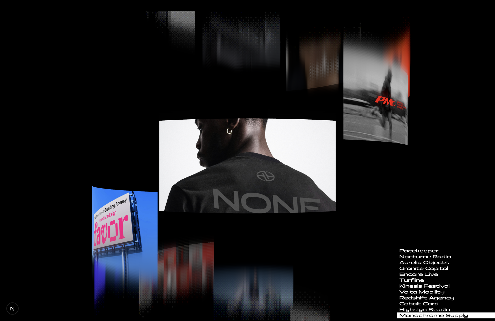

# Dither Blur

A WebGL carousel where cards ride a vertical helix and dissolve into an ordered
dither as they recede. Three separate dithers run at once — one keyed to screen
position, one to hover, one to a cursor trail — over a progressive directional
blur. Every parameter is live-tunable from a panel in the browser.

Built with Three.js and Next.js.



## Running it

```bash
npm install
npm run dev
```

Then open http://localhost:3000.

**Press `g` to open the tuning panel.** It starts hidden. Nothing in the effect
is hard-coded — every number lives in [`gl/config.js`](gl/config.js) and is
wired to a slider, so the whole look can be dialled in the browser rather than
by editing shaders.

### Controls

| | |
|---|---|
| scroll / drag | turn the helix |
| hover a card | rack focus — that card resolves, the rest recede |
| click a card | bring it to the centre |
| move the cursor | paint a dither trail |
| `g` | toggle the tuning panel |

## How it works

Per frame:

```
cards → card buffer ─┐
                     │
cards → scene target ┼→ blur chain (4 levels) ─┐
                     │                         │
        cursor trail ┴─────────────────────────┴→ composite → screen
```

**Cards** ([`gl/shaders/card.js`](gl/shaders/card.js)) aren't flat quads. The
vertex shader bends each subdivided plane onto a cylinder, so a card's left and
right edges recede in Z while its centre faces you. Position comes entirely from
the shader — the CPU-side geometry is a flat plane at the origin — which is why
frustum culling is off and picking doesn't use a raycaster.

**The card buffer** ([`gl/cardbuffer.js`](gl/cardbuffer.js)) re-renders the same
geometry to an offscreen target with a flat fragment shader, packing card id,
dim amount, hover amount and entry progress into R, G, B and A. It reuses the
card vertex shader verbatim, so it inherits the helix position and bend for
free. The red channel is read back a pixel at a time for hit testing; the rest
feed the composite.

**The blur chain** ([`gl/post.js`](gl/post.js)) is a separable directional blur
run twice per level — along the streak axis at full spread, across it at a
fraction — giving an elliptical kernel. A symmetric blur reads as "out of
focus"; a stretched one reads as motion.

**The trail** ([`gl/trail.js`](gl/trail.js)) is a persistent ping-ponged buffer.
Each frame is the last one decayed and smeared outward, plus a stroke painted
along the segment the cursor actually covered — a segment, not a dot, so fast
flicks stay continuous. It stores intensity in R and the velocity at paint time
in GB, which is what lets the composite warp the image along the direction of
travel.

**The composite** ([`gl/shaders/composite.js`](gl/shaders/composite.js)) does
the rest: walks up the blur chain by depth, converts to display space, then
applies the three dithers. Each has its own palette, tone curve, cell size and
dissolve mode.

### The entry

On load the helix is parked a few slots back and every card is absent — not
faded, not drawn at all. Once the last texture is in, two clocks start: a timed
tween glides the helix into place, and each card materializes as a dithered disc
opening out from its own centre, in a running order reshuffled every time.

The reveal lives in the card pass rather than the composite, which is what keeps
a card that hasn't arrived out of the blur chain — blend it toward the
background instead and its light still smears into streaks across the frame. A
cell is either the image at full strength or nothing, so it reads as the picture
assembling rather than as an opacity ramp. The composite then prints its own
dither over whatever has arrived but not yet settled, keyed to the same
per-card progress, so a card doesn't snap straight to a clean photograph.

It plays once per load, so the panel has a **replay** button next to it.

### The dither

Luminance is crushed to a few discrete steps against a Bayer threshold, then
read off a three-stop `ink → accent → paper` ramp. `mono` blends that against
the same quantization done per channel, which keeps the image's own hues.

Two things worth knowing before changing it:

- **Cell snapping matters.** The composite is resampled at the cell centre so
  colour and threshold both hold constant across a cell and it fills flat.
  Without it each cell carries full-resolution detail wearing a dot pattern,
  which reads as noise laid over the image instead of the image being printed.
- **Setting `ink` and `paper` to the same colour turns the ramp into a band.**
  Both ends of the tone range collapse together and only the midtones lift to
  the accent. That's the default here, and it's what keeps the pattern reading
  as grain rather than posterisation.

## Layout

```
app/                 Next.js shell — one page, one canvas
components/          Carousel.jsx, mounts the GL scene and renders the labels
gl/
  config.js          every tunable, wired to the panel
  scene.js           renderer, cards, hover, the frame loop
  scroll.js          wheel/drag/touch into one number, with snap and tweens
  post.js            blur chain + composite pipeline
  cardbuffer.js      offscreen id/dim/hover/entry pass
  trail.js           cursor trail buffer
  gui.js             lil-gui panel
  color.js           hex to display-space vector
  shaders/           card, composite, trail, shared dither
```

## Using your own images

Replace the files in `public/`, point `IMAGES` in
[`gl/config.js`](gl/config.js) at them, and update `PROJECTS` to match. Keep
both arrays the same length or the labels drift out of step with the cards.

Please do replace them — see below.

## Credits and licensing

Code is MIT, © Yousuf Soomro.

**The images in `public/` are not mine and are not covered by that license.**
They're placeholders pulled from Behance while building this. If you made one
and want it credited or taken down, [open an issue](../../issues) — happy to do
either. If you're forking this, swap them for something you have the rights to.

Full details in [CREDITS.md](CREDITS.md).
